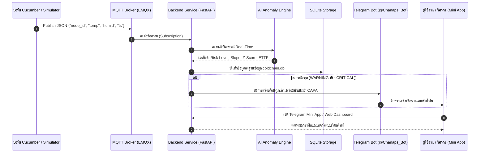

# บทที่ 1: สถาปัตยกรรมระบบ (System Architecture)

> เรียนรู้การออกแบบระบบ IoT และ AI แบบ End-to-End เพื่อรองรับสภาพแวดล้อมที่ต้องการความเสถียร 24 ชั่วโมงต่อวัน

---

## 1.1 ปรัชญาการออกแบบระดับอุตสาหกรรม (Industrial IoT Principles)

ในงานระดับผู้บริโภคทั่วไป (Consumer IoT) เซ็นเซอร์อาจหลุดหรือหน่วงได้โดยไม่ส่งผลร้ายแรง แต่ในระบบ **Cold Chain และ Data Center** การออกแบบต้องยึดหลักสำคัญ 3 ประการ:

1. **High Reliability & Low Latency:** ข้อมูลต้องส่งถึงคลาวด์ภายในไม่เกิน 2–3 วินาที เพื่อให้ระบบตรวจจับการเปลี่ยนแปลงของอุณหภูมิได้อย่างทันท่วงที
2. **Predictive Alerting over Threshold Alerting:** หากรอให้อุณหภูมิเกิน 8°C แล้วค่อยแจ้งเตือน สินค้าในตู้แช่อาจเริ่มเสื่อมสภาพแล้ว ระบบที่ดีต้อง **พยากรณ์ล่วงหน้า (Predictive Warning)** จากอัตราการไต่ขึ้นของความชัน (Trend Slope)
3. **Decoupled Architecture:** อุปกรณ์ภาคสนาม (บอร์ด Cucumber) ไม่ควรเชื่อมต่อกับหน้าเว็บหรือแอปพลิเคชันโดยตรง แต่ควรผ่าน Message Broker (MQTT) เพื่อความปลอดภัยและการขยายตัว (Scalability)

---

## 1.2 โครงสร้างข้อมูลและการเดินทางของข้อมูล (Data Pipeline)

---

## 1.3 ส่วนประกอบหลักของระบบ (System Components)

| ชั้นการทำงาน | เทคโนโลยีที่ใช้ | หน้าที่หลัก |
|---|---|---|
| **ฮาร์ดแวร์ IoT** | บอร์ด Cucumber (ESP32) + HTS221 | เก็บข้อมูลอุณหภูมิและความชื้น แปลงเป็น JSON |
| **ตัวจำลอง (Simulator)** | Python 3 + `paho-mqtt` | จำลองสภาวะปกติ, คอมเพรสเซอร์ดับ, ประตูเปิดค้าง |
| **เครือข่ายสื่อสาร** | MQTT (TCP/IP Port 1883) | สื่อสารข้อมูลน้ำหนักเบาและประหยัดแบนด์วิดท์ |
| **เซิร์ฟเวอร์ Backend** | FastAPI + Uvicorn | รับข้อมูล, บันทึกฐานข้อมูล SQLite, บริการ REST API |
| **เอนจิน AI** | Scikit-learn + Heuristic Slope | วิเคราะห์ความชัน, คำนวณ Z-Score, ประเมิน ETTF |
| **ส่วนติดต่อผู้ใช้ (UI)** | HTML5, CSS3, JS, Chart.js | แสดงเกจวัด, กราฟแนวโน้ม, รองรับ Telegram SDK |
| **ช่องทางแจ้งเตือน** | Telegram Bot API | ยิงแจ้งเตือนเหตุด่วนเข้าสมาร์ตโฟนของวิศวกร |
