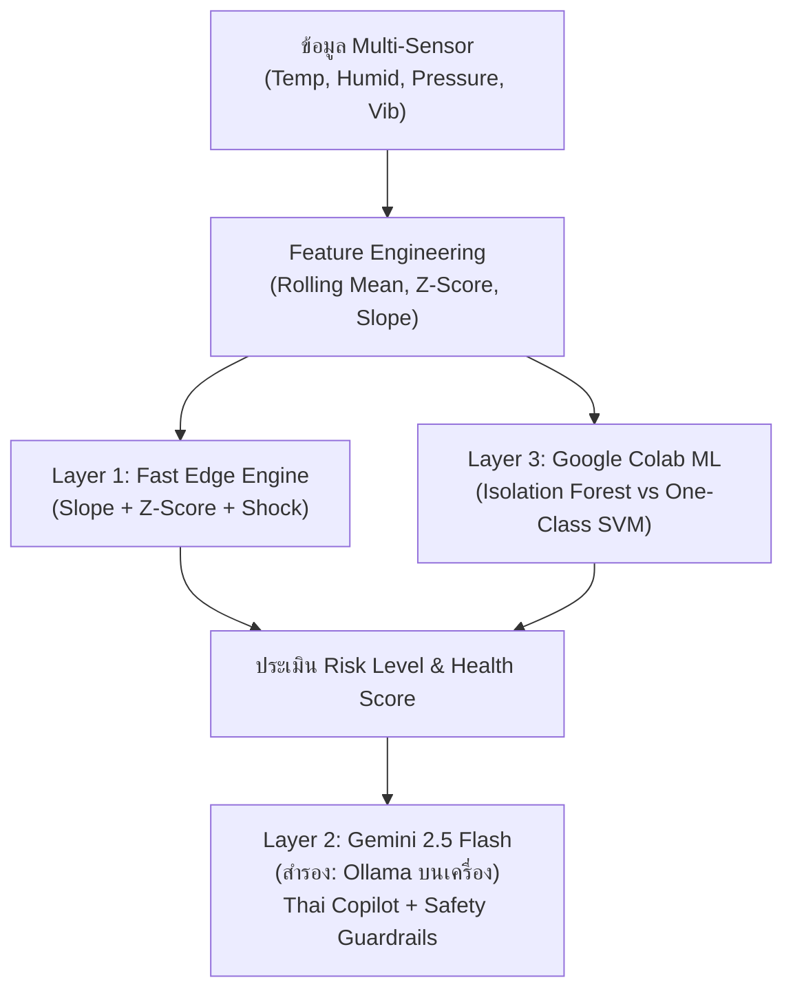

# บทที่ 4: ปัญญาประดิษฐ์ตรวจจับวิกฤต (AI Anomaly Detection)

> หัวใจสำคัญของ AIoT: การเปลี่ยนจาก "ระบบดูย้อนหลัง" สู่ "ระบบพยากรณ์ล่วงหน้าก่อนของเสียหาย"

---

## 4.1 ขีดจำกัดของระบบแจ้งเตือนแบบเดิม (Rule-Based vs AIoT)

ในระบบเฝ้าระวังตู้แช่ยุคเก่า มักใช้กฎแบบพื้นฐาน (Hard Threshold):

$$\text{IF } \text{Temp} > 8.0^\circ\text{C} \implies \text{TRIGGER ALARM}$$

**ปัญหาของวิธีนี้คืออะไร?**
เมื่ออุณหภูมิแตะ 8.1°C นั่นแปลว่า **ระบบทำความเย็นดับไปแล้วเป็นเวลา 20–30 นาที!** ความเย็นเริ่มระเหย และยาปฏิชีวนะหรือวัคซีนอาจเสื่อมสภาพไปแล้วบางส่วน

**แนวทางของระบบ AIoT ในโปรเจกต์นี้:**
เรานำ AI เข้ามาวิเคราะห์ **"ความชันของการเปลี่ยนแปลง (Trend Slope)"** ร่วมกับ **"ค่าเบี่ยงเบนทางสถิติ (Z-Score)"**:
หากอุณหภูมิปัจจุบันยังอยู่ที่ 5.5°C (ยังไม่เกิน 8°C) แต่อุณหภูมิไต่ขึ้นเร็วต่อเนื่อง $0.3^\circ\text{C}$ ทุกๆ 2 วินาที **AI จะส่งสัญญาณ PREDICTIVE WARNING ทันที** พร้อมประเมินเวลาที่เหลือก่อนวิกฤต (ETTF)

---

## 4.2 สถาปัตยกรรม Triple-Layer Hybrid AI

ระบบประกอบด้วย AI 3 ชั้นทำงานร่วมกัน:

### 1. Rolling Linear Slope Formula
คำนวณความชันจากชุดข้อมูล $N$ จุดล่าสุด ($N=15$):

$$\text{Slope} = \frac{\sum (x_i - \bar{x})(y_i - \bar{y})}{\sum (x_i - \bar{x})^2}$$

- $\text{Slope} \le 0.05$: สภาวะปกติ ความเย็นคงที่
- $\text{Slope} > 0.15$: **วิกฤตแฝง!** คอมเพรสเซอร์หยุดทำงาน หรือประตูปิดไม่สนิท

### 2. Statistical Z-Score

$$Z = \frac{\text{Temp} - \mu}{\sigma}$$

ตรวจจับกรณีเซ็นเซอร์เสีย (Sensor Glitch) หรือมีคลื่นแม่เหล็กรบกวนกะทันหัน

### 3. Estimated Time to Failure (ETTF)
พยากรณ์เวลาที่เหลือก่อนสินค้าจะเสียหาย:

$$\text{ETTF} = \frac{T_{\text{max}} - T_{\text{current}}}{\text{Slope}} \times \Delta t$$

---

## 4.3 การทดลองบน Google Colab (Hands-on Notebook)

เราได้เตรียมสมุดงาน **Jupyter Notebook** อยู่ที่:
`notebooks/colab_aiot_anomaly_training.ipynb`

### สิ่งที่ผู้เรียนจะได้ทดลองใน Colab:
1. สร้างข้อมูล Multi-Sensor 600 สเต็ป (ช่วงปกติ + เหตุการณ์แรงกระแทก MPU6050 + คอมเพรสเซอร์ดับ)
2. เขียนโค้ดสกัด Features (`temp_slope`, `z_score`, `vib_g`, `pressure`) ด้วย Pandas
3. เทรนและเปรียบเทียบ **Isolation Forest vs One-Class SVM** พร้อมดู Precision / Recall / F1-Score
4. พล็อตกราฟ Dual-Axis แสดงอุณหภูมิและแรงสั่นสะเทือนพร้อมจุดแจ้งเตือน AI
