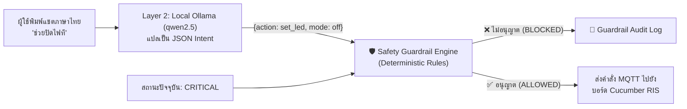

# บทที่ 9: ความปลอดภัยของ AI และ Guardrails (AI Safety & Guardrails)

> แนวคิดสำคัญของระบบ AIoT ระดับอุตสาหกรรม: **"ให้ AI คิดและแปลความหมาย แต่ให้กฎที่ตรวจสอบได้ (Deterministic Guardrails) เป็นผู้ตัดสินใจขั้นสุดท้ายก่อนสั่งฮาร์ดแวร์จริง"**

---

## 9.1 ทำไมไม่ควรให้ LLM สั่งฮาร์ดแวร์โดยตรง?

ในการนำโมเดลภาษาขนาดใหญ่ (เช่น Local Ollama `qwen2.5` หรือ Gemma) มาควบคุมบอร์ด IoT จริง มีความเสี่ยงสำคัญ 3 ประการ:

1. **Prompt Injection / คำสั่งกำกวม:** ผู้ใช้อาจพิมพ์ข้อความหลอกล่อหรือพิมพ์ผิด เช่น *"ช่วยปิดไฟเตือนที รำคาญตา"* ในขณะที่ตู้แช่วัคซีนกำลังอยู่ในภาวะ **CRITICAL**
2. **Hallucination (AI แต่งคำสั่งเอง):** โมเดลอาจสร้างพารามิเตอร์ที่ฮาร์ดแวร์ไม่รองรับ
3. **ขาดหลักฐานการตรวจสอบ (Auditability):** มาตรฐาน GMP / FDA บังคับให้ทุกคำสั่งที่ส่งไปยังอุปกรณ์ควบคุมต้องมี Audit Trail ย้อนหลังได้

---

## 9.2 สถาปัตยกรรม Guardrail Gateway ในโปรเจกต์นี้



---

## 9.3 ตัวอย่างกฎความปลอดภัยจริง (`backend/ai_copilot.py`)

```python
class SafetyGuardrails:
    def validate(self, action: str, params: dict, ai_state: dict) -> tuple[bool, str]:
        risk = ai_state.get("risk_level", "NORMAL")

        if action == "set_led":
            mode = str(params.get("mode", "")).lower()
            force = bool(params.get("force", False))
            if mode not in ("safe", "warning", "critical", "off"):
                return False, f"BLOCKED: โหมดไฟ '{mode}' ไม่อยู่ในรายการที่อนุญาต"
            if mode == "off" and risk == "CRITICAL" and not force:
                return (
                    False,
                    "BLOCKED BY SAFETY GUARDRAIL: ห้ามปิดไฟแจ้งเตือนขณะระบบอยู่ในสถานะ CRITICAL! "
                    "(หากต้องการปิดจริง ให้พิมพ์ระบุ 'บังคับปิดไฟ')",
                )
            return True, f"ALLOWED: ผ่านกฎความปลอดภัย สั่งเปลี่ยนไฟ RGB LED -> {mode}"
```

### กิจกรรมทดลองสำหรับผู้เรียน
1. กดปุ่ม **🚨 คอมฯ ดับ** บนหน้า Dashboard ให้ระบบเข้าสู่สถานะ `CRITICAL`
2. พิมพ์ในช่อง AI Copilot Chat ว่า **`"ปิดไฟ"`** -> สังเกตว่า Guardrail จะขึ้นป้าย **`GUARDRAIL BLOCKED`** และไฟบนบอร์ด Cucumber จะยังคงกระพริบแดงเตือนต่อไป!
3. ลองพิมพ์ใหม่ว่า **`"บังคับปิดไฟ"`** -> Guardrail จะอนุญาตแบบ Override และบันทึกหลักฐานลงใน **Guardrail Audit Log** ทันที
