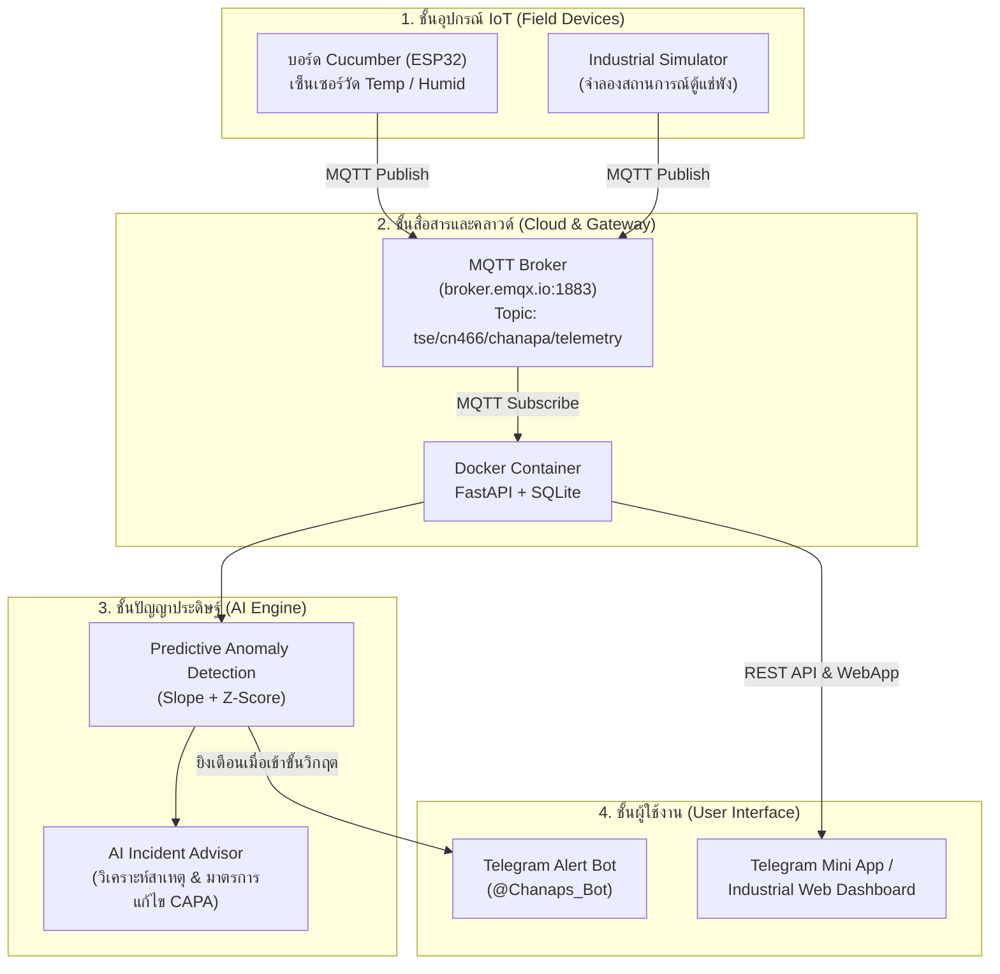

# 🏭 AIoT for Industry — ระบบเฝ้าระวังตู้แช่ยา & ห้อง Server

> **หลักสูตรการเรียนรู้และพัฒนาเทคโนโลยี AIoT ระดับอุตสาหกรรม (Industrial AIoT Learning Platform)**  
> **วิชา:** CN466 Project - Internet of Things & AI | มหาวิทยาลัยธรรมศาสตร์ (TSE)  
> **ผู้พัฒนา:** ชนาภา สดุดี (รหัสนักศึกษา: 6610680214)

---

## 💡 ภาพรวมของระบบ (Overview)

ในภาคอุตสาหกรรม การแพทย์ และดาต้าเซ็นเตอร์ **"ความเย็น"** คือหัวใจสำคัญของความอยู่รอดทางธุรกิจ:
- **ตู้แช่ยาและวัคซีน (Cold Chain):** หากอุณหภูมิหลุดจากช่วง **2°C – 8°C** เกิน 2 ชั่วโมง ยาและชีววัตถุอาจเสื่อมสภาพ มูลค่าความเสียหายต่อครั้งสูงถึง **หลักแสนถึงหลักล้านบาท**
- **ห้อง Server / Data Center:** หากระบบปรับอากาศล้มเหลว อุณหภูมิที่สูงเกิน **25°C** จะทำให้เซิร์ฟเวอร์ตัดการทำงาน เกิดภาวะ Downtime ธุรกิจหยุดชะงักทันที

โปรเจกต์นี้จึงถูกออกแบบมาเพื่อ **สอนและสาธิตการสร้างระบบ AIoT แบบครบวงจร (End-to-End AIoT Platform)** โดยผสานการทำงานระหว่าง:
1. **บอร์ดไมโครคอนโทรลเลอร์ Cucumber (ESP32)** ทำหน้าที่อ่านค่าเซ็นเซอร์จริง (หรือ Industrial Simulator)
2. **ระบบรับส่งข้อมูลแบบ Real-Time ผ่านโพรโทคอล MQTT** สู่ Cloud Broker
3. **เอนจินปัญญาประดิษฐ์ (Predictive AI Anomaly Engine)** บน Python / Colab ที่ไม่เพียงแค่ดูค่าปัจจุบัน แต่คำนวณ **"อัตราความชันการเพิ่มของอุณหภูมิ (Trend Slope)"** เพื่อส่งสัญญาณเตือนล่วงหน้าก่อนที่ยาจะเสียหาย
4. **ส่วนติดต่อผู้ใช้งาน (UI) ผ่าน Telegram Mini App และ Web Dashboard** แสดงผลกราฟิกและแจ้งเตือนวิกฤตถึงมือวิศวกรแบบเรียลไทม์

---

## 📐 แผนภาพสถาปัตยกรรมระบบ (System Architecture)

---

## 🎯 กลุ่มเป้าหมายของหลักสูตร (Target Audience)

หลักสูตรนี้จัดทำขึ้นโดยเน้นกลุ่มเป้าหมาย **"วิศวกรโรงงาน, ช่างเทคนิคอาชีวะ/อุตสาหกรรม และนักศึกษาด้านวิศวกรรมคอมพิวเตอร์และ IoT"** เพื่อให้สามารถนำความรู้ไปประยุกต์ใช้งานเชิงพาณิชย์และมาตรฐานอุตสาหกรรม (GMP / GDP / FDA) ได้จริง

| บทเรียน | เนื้อหาหลัก | สิ่งที่จะได้ลงมือทำ |
|:---:|---|---|
| **[บทที่ 1](01_system_architecture.md)** | สถาปัตยกรรมระบบ IoT ระดับอุตสาหกรรม | เข้าใจ Data Flow ตั้งแต่ฮาร์ดแวร์ถึงคลาวด์ |
| **[บทที่ 2](02_cucumber_hardware.md)** | บอร์ด Cucumber & เซ็นเซอร์ | ต่อวงจร, อัปโหลดเฟิร์มแวร์ C++ หรือใช้ Simulator |
| **[บทที่ 3](03_mqtt_cloud_broker.md)** | การสื่อสารผ่าน MQTT Broker | ตั้งค่าการส่ง Payload JSON และ QoS |
| **[บทที่ 4](04_ai_anomaly_detection.md)** | ปัญญาประดิษฐ์ตรวจจับวิกฤต (AI Anomaly) | เทรนโมเดลบน Google Colab & เขียนเอนจิน Slope |
| **[บทที่ 5](05_telegram_mini_app.md)** | UI & Telegram Mini App | สร้าง Dashboard ด้วย HTML/JS & ฝัง SDK Telegram |
| **[บทที่ 6](06_docker_deployment.md)** | การติดตั้งใน Docker & Dev Tunnels | Pack เป็นคอนเทนเนอร์ & ทำ Port Forwarding (HTTPS) |
| **[บทที่ 7](07_business_case.md)** | โมเดลธุรกิจ & ความคุ้มค่าทางเศรษฐกิจ | การคิด ROI และการเปิดบริการ B2B SaaS |
| **[บทที่ 8](08_video_walkthrough.md)** | สคริปต์คลิปนำเสนอ AI Flow ส่งงาน | แนวทางการบันทึกคลิปส่งอาจารย์ |
