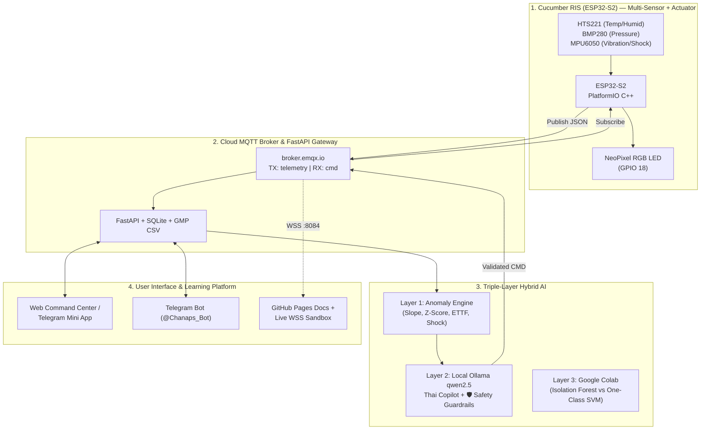

# 🏭 AIoT for Industry — ระบบเฝ้าระวังตู้แช่ยา & ห้อง Server

  <h3>แพลตฟอร์มการเรียนรู้และระบบ AIoT แบบสองทางระดับอุตสาหกรรม (Full-Stack Bidirectional AIoT)</h3>
  

    ผสานฮาร์ดแวร์จริง <strong>บอร์ด Cucumber RIS (ESP32-S2)</strong> อ่านเซ็นเซอร์พร้อมกัน 3 ชนิด (<strong>HTS221 + BMP280 + MPU6050</strong>) 
    ควบคุมไฟ <strong>NeoPixel RGB LED</strong> ผ่าน MQTT สองทาง ขับเคลื่อนด้วย <strong>Triple-Layer Hybrid AI</strong> 
    (Predictive Slope/Shock Engine + Local Ollama <code>qwen2.5</code> Copilot + Deterministic Safety Guardrails + Google Colab) 
    พร้อม UI ผ่าน <strong>Web Command Center & Telegram Mini App</strong>
  

  

    <strong>วิชา:</strong> CN466 Internet of Things &amp; AI
    <strong>ผู้พัฒนา:</strong> ชนาภา สดุดี (6610680214)
    <a class="hero-cta" href="live_sandbox/">ทดลอง Live MQTT Sandbox →</a>
  

---

## 📐 แผนภาพสถาปัตยกรรมระบบ (System Architecture)

---

## 📚 เส้นทางการเรียนรู้ (แบ่งแทร็กตามบทบาท)

### 🎓 สำหรับผู้เรียน (Learner Track)

  <a class="course-card" href="01_system_architecture/">
    บทที่ 01
    <h4>สถาปัตยกรรมระบบ AIoT</h4>
    
Data Pipeline ระดับอุตสาหกรรมตั้งแต่เซ็นเซอร์ถึง AI และแอคชูเอเตอร์

  </a>
  <a class="course-card" href="02_cucumber_hardware/">
    บทที่ 02
    <h4>บอร์ด Cucumber RIS & Multi-Sensor</h4>
    
สแกน I2C (HTS221 + BMP280 + MPU6050) และคุมไฟ NeoPixel RGB LED

  </a>
  <a class="course-card" href="03_mqtt_cloud_broker/">
    บทที่ 03
    <h4>การสื่อสาร MQTT สองทาง</h4>
    
การ Publish Telemetry และ Subscribe Command บน Public Broker EMQX

  </a>
  <a class="course-card" href="04_ai_anomaly_detection/">
    บทที่ 04
    <h4>AI Anomaly & Google Colab</h4>
    
Predictive Slope, Z-Score, ETTF และ Workshop เทรน Isolation Forest vs OC-SVM

  </a>
  <a class="course-card" href="05_telegram_mini_app/">
    บทที่ 05
    <h4>UI, AI Copilot & Telegram Mini App</h4>
    
แดชบอร์ด Command Center, แชตภาษาไทยคุมบอร์ดจริง และ Telegram Bot

  </a>
  <a class="course-card featured" href="live_sandbox/">
    เล่นสด · ไม่ต้องติดตั้ง
    <h4>Live MQTT Sandbox (เล่นสดทันที)</h4>
    
ต่อ WSS ดูค่าสดจากบอร์ด Cucumber หรือทดลองจำลองวิกฤตบน GitHub Pages

  </a>

### 🧑‍🏫 สำหรับผู้สอนและวิศวกร (Instructor & Engineer Track)

  <a class="course-card" href="06_docker_deployment/">
    บทที่ 06
    <h4>การติดตั้ง Docker & Dev Tunnels</h4>
    
รันระบบด้วย Docker Compose และเปิด HTTPS Port Forwarding

  </a>
  <a class="course-card" href="07_business_case/">
    บทที่ 07
    <h4>โมเดลธุรกิจ & ความคุ้มค่า (ROI)</h4>
    
B2B SaaS Cold Chain, มาตรฐาน GMP/GDP/FDA และการคำนวณจุดคุ้มทุน

  </a>
  <a class="course-card" href="09_ai_safety_guardrails/">
    บทที่ 08
    <h4>ความปลอดภัย AI & Guardrails</h4>
    
การออกแบบ Deterministic Guardrails ป้องกัน AI สั่งงานอันตรายต่อฮาร์ดแวร์

  </a>
  <a class="course-card" href="08_video_walkthrough/">
    บทที่ 09
    <h4>สคริปต์คลิปนำเสนอ AI Flow</h4>
    
แนวทางอัดคลิปส่งงาน 3–5 นาที อธิบายการสั่งงานและตรวจงานกับ AI

  </a>

