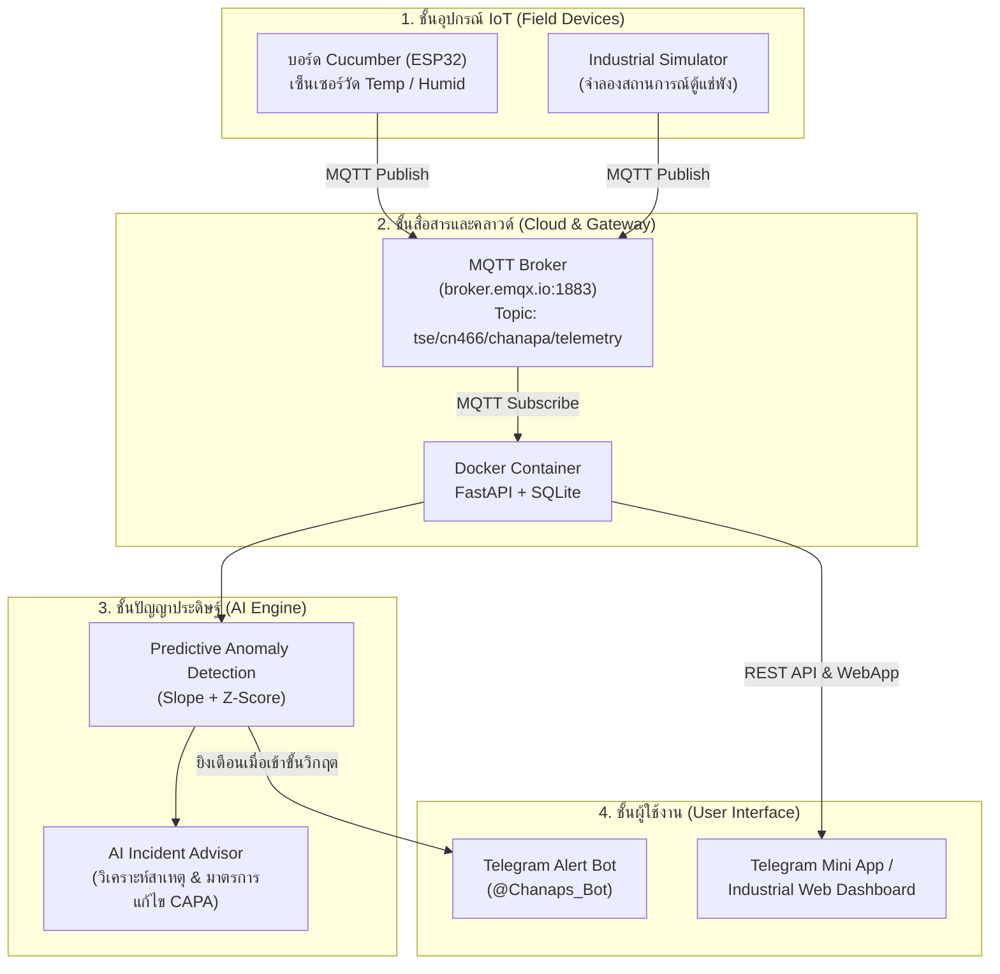

# 🏭 AIoT for Industry — ระบบเฝ้าระวังตู้แช่ยา & ห้อง Server

  <h3>🌟 แพลตฟอร์มการเรียนรู้และพัฒนาระบบ AIoT ระดับอุตสาหกรรม (Industrial AIoT)</h3>
  

    ออกแบบและพัฒนาสำหรับการเฝ้าระวังและตรวจจับความผิดปกติของตู้แช่ยา วัคซีน และห้อง Server แบบเรียลไทม์ 
    ด้วยการผสานฮาร์ดแวร์ <strong>บอร์ด Cucumber (ESP32)</strong>, โพรโทคอล <strong>MQTT</strong>, 
    เอนจิน <strong>AI Predictive Anomaly Detection</strong>, และ <strong>Telegram Mini App</strong>
  

  

    <strong>วิชา:</strong> CN466 Project - Internet of Things & AI | มหาวิทยาลัยธรรมศาสตร์ (TSE) 
    <strong>ผู้พัฒนา:</strong> ชนาภา สดุดี (รหัสนักศึกษา: 6610680214)
  

---

## 💡 ภาพรวมและความสำคัญทางธุรกิจ (Business Value)

ในภาคอุตสาหกรรม การแพทย์ และศูนย์ข้อมูล (Data Center) **"ความเย็น"** คือหัวใจสำคัญของความอยู่รอดทางธุรกิจ:

- 💊 **ตู้แช่ยาและวัคซีน (Cold Chain):** หากอุณหภูมิหลุดจากช่วง **2°C – 8°C** เกิน 2 ชั่วโมง ยาและชีววัตถุอาจเสื่อมสภาพ มูลค่าความเสียหายต่อครั้งสูงถึง **300,000 – 5,000,000 บาท**
- 🖥️ **ห้อง Server / Data Center:** หากระบบปรับอากาศล้มเหลว อุณหภูมิที่สูงเกิน **25°C** จะทำให้เซิร์ฟเวอร์ตัดการทำงาน เกิดภาวะ Downtime ธุรกิจหยุดชะงัก มูลค่าความเสียหายนาทีละหลายหมื่นบาท

โปรเจกต์นี้จึงสร้างขึ้นเพื่อ **แก้ Pain Point จากระบบแจ้งเตือนแบบเดิม** ที่มักเตือนช้าเกินไป โดยเปลี่ยนมาใช้ **AI วิเคราะห์ความชัน (Trend Slope)** เพื่อส่งสัญญาณเตือนล่วงหน้าก่อนที่สินค้าจะเสียหายจริง!

---

## 📐 แผนภาพสถาปัตยกรรมระบบ (System Architecture)

---

## 📚 สารบัญบทเรียนในหลักสูตร (Curriculum Modules)

  

    <h4><a href="01_system_architecture/">บทที่ 1: สถาปัตยกรรมระบบ</a></h4>
    
สถาปัตยกรรมระดับอุตสาหกรรม การออกแบบ Data Pipeline แบบ End-to-End

  

  

    <h4><a href="02_cucumber_hardware/">บทที่ 2: บอร์ด Cucumber & เซ็นเซอร์</a></h4>
    
การต่อวงจรเซ็นเซอร์ HTS221 (I2C), โค้ด C++ และการใช้งาน Simulator

  

  

    <h4><a href="03_mqtt_cloud_broker/">บทที่ 3: การสื่อสารผ่าน MQTT</a></h4>
    
การเชื่อมต่อ Public Broker (EMQX), การจัดรูปแบบ JSON Telemetry และ QoS

  

  

    <h4><a href="04_ai_anomaly_detection/">บทที่ 4: AI Anomaly Detection</a></h4>
    
โมเดลสถิติ Z-Score, การคำนวณ Trend Slope, ETTF และโมเดล Colab

  

  

    <h4><a href="05_telegram_mini_app/">บทที่ 5: UI & Telegram Mini App</a></h4>
    
การพัฒนา Dashboard บนมือถือ, การฝัง SDK Telegram และระบบ Haptic

  

  

    <h4><a href="06_docker_deployment/">บทที่ 6: การติดตั้งและรันระบบ</a></h4>
    
การ Pack ลง Docker Container และการทำ Port Forwarding (HTTPS)

  

  

    <h4><a href="07_business_case/">บทที่ 7: โมเดลธุรกิจ & ความคุ้มค่า</a></h4>
    
การคำนวณ ROI ความคุ้มค่าทางเศรษฐกิจ มาตรฐาน GMP/FDA และ B2B SaaS

  

  

    <h4><a href="08_video_walkthrough/">บทที่ 8: สคริปต์คลิปนำเสนอ AI Flow</a></h4>
    
แนวทางการบันทึกคลิปส่งงาน 3-5 นาที อธิบายกระบวนการสั่งงานและตรวจงาน AI

  

